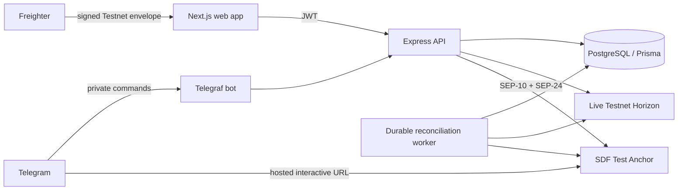

# StellarDrop

A multi-page Next.js application, Express API, PostgreSQL database, and Telegram bot for sending **live Stellar Testnet USDC** with a claim code. Senders sign in with a verified email and receive an encrypted custodial Stellar wallet automatically; Freighter is optional for existing wallet owners. Recipients claim in Telegram and withdraw through the **real SDF Test Anchor’s SEP-10 and SEP-24 endpoints**. Fiat payouts are simulated by the anchor. There is no mainnet mode and no mocked ledger implementation.

## Run locally

Requires Node.js 22.12+ (Node 24 recommended), npm, PostgreSQL 18 or Docker, and a Resend account (or Mailpit for local development). Create a Telegram bot with [BotFather](https://t.me/BotFather) to use the recipient flow. The Freighter extension is optional.

```sh
npm install
cp .env.example .env
openssl rand -hex 32  # ENCRYPTION_KEY: use the full 64-character output
openssl rand -hex 32  # JWT_SECRET: generate a separate value
docker compose up -d postgres
npm run db:generate
npm run db:migrate
npm run dev
```

Set `ENCRYPTION_KEY`, `JWT_SECRET`, `TELEGRAM_BOT_TOKEN`, and `TELEGRAM_BOT_USERNAME` in `.env`. For verification emails, set `EMAIL_PROVIDER=resend`, `RESEND_API_KEY` to a Resend sending API key, and `EMAIL_FROM` to an address on your verified sending domain, such as `StellarDrop <hello@your-domain.com>`. Add the DNS records shown in Resend and wait for the domain to show **Verified**. The app sends through Resend's HTTPS API; SMTP credentials and a Resend webhook are not required. See [the Resend setup instructions](docs/NETLIFY.md#connect-resend) for deployment and testing details.

For a local inbox, set `EMAIL_PROVIDER=smtp` and `EMAIL_FROM="StellarDrop <hello@stellardrop.test>"`, run `docker compose up -d mailpit`, and use the default `127.0.0.1:1025` SMTP settings without credentials. Verification emails then appear at **http://localhost:8025**. `npm run smtp:verify` checks SMTP connection/authentication without sending an email; it does not check Resend. Never point production login at an unprotected test inbox. Production SMTP connections require TLS.

Leave both master escrow keys empty for automatic generation. The first startup persists the escrow key **encrypted in PostgreSQL before funding it with Friendbot**. Subsequent starts reuse it. Preserve the encryption key and back up PostgreSQL together; losing either can make existing custody wallets unrecoverable. An explicitly configured escrow must match the persisted one.

Web: **http://localhost:3000**. API: **http://localhost:4000**. `npm run dev` starts both. Bot long polling runs in the API process. Do not run multiple polling replicas for one token. If no bot token is configured, web/API work and share pages explicitly show that Telegram claiming is unavailable.

`NEXT_PUBLIC_API_URL` is embedded at web build time. Restart/rebuild Next.js after changing it. Root `.env` is loaded by both workspaces. `WEB_ORIGIN` must match the web origin exactly. Never prefix server secrets with `NEXT_PUBLIC_`.

## Try the full flow

1. Open `/login` or `/dashboard`, enter your email, and submit the six-digit code delivered by email. Only then is your Stellar keypair generated and encrypted. You enter the dashboard immediately while Friendbot funding and the USDC trustline are prepared. Signing in again with the same email restores the same wallet. No extension or password is required. Existing wallet owners can choose **Use Freighter**, set it to **Testnet**, and approve a sequence-zero ownership challenge instead.
2. Your email wallet activates automatically; retry **wallet setup** if Testnet services are temporarily unavailable. External wallets can use **Get test XLM** and **Add USDC trustline**. Get the exact Testnet USDC asset from [Circle’s faucet](https://faucet.circle.com) or use a Testnet XLM → USDC path payment where liquidity exists. Friendbot supplies XLM, **not USDC**.
3. Open `/dashboard/create`, choose an amount, and click **Create drop** to approve the transfer. For an email wallet, the server signs the prepared funding intent using that authenticated user's encrypted key; an external wallet signs it in Freighter. A single atomic transaction pays the escrow and creates the claimable balance. The claim code becomes available only after successful ledger inclusion.
4. Share `/drop/CODE` through WhatsApp or Telegram. The share message contains the configured bot’s actual deep link. Claim codes are bearer credentials: share them privately.
5. The recipient opens the link in Telegram. The bot persists an encrypted keypair, funds XLM, establishes the USDC trustline, then atomically claims the escrow balance and pays the receiver. `/balance` reads live Horizon state. A second receiver cannot reserve the same code; repeat claims by the first receiver return the existing result.
6. Type `/withdraw` or `/withdraw 2`. Complete the **SDF-hosted** interactive page with **test data only**. The worker waits for `pending_user_transfer_start`, submits the payment with the exact destination, amount, and memo, and polls until the anchor completes the simulated payout. `/status` shows progress and a Testnet explorer link.

At implementation time the live anchor advertises USDC withdrawals between **1 and 10 USDC**. Limits are read from `/sep24/info` for each initialization. Larger balances can be withdrawn in multiple requests; per-drop allocations track partial withdrawals and a drop becomes `WITHDRAWN` only after its full amount settles. The anchor chooses the off-chain currency in its hosted UI. StellarDrop reports NGN only when the anchor actually returns NGN; it cannot force an unsupported fiat currency or make a real bank payment.

## Architecture



- `apps/web`: App Router landing, email sign-in, protected sender dashboard, create, and dynamic share routes. Responsive Tailwind/CSS interface, real account/wallet state, empty/error/loading states, filterable drop table, live refresh, and safe pending-transaction retries.
- `apps/api`: Express, Telegraf, Stellar services, SEP clients, and recovery worker. `src/index.ts` performs initialization and starts workers; `src/app.ts` exposes the API independently for testing.
- `packages/shared`: immutable Testnet configuration, shared API types, and exact integer arithmetic for Stellar’s seven decimal places.
- `prisma`: the requested three core models, plus durable email/wallet auth challenges, funding intents, ledger jobs, claim reservations, encrypted system keys, withdrawals, and a Telegram update queue. `User.emailVerifiedAt` records successful proof of inbox ownership. `withdrawnAmount` tracks partial settlements. The original `bankDetailsJson` field remains in the requested schema but is **never written**.

### Claimable balances and transaction safety

Stellar’s `claimClaimableBalance` releases assets to the claimant’s operation source. Since the escrow is the sole claimant, it cannot directly claim into somebody else’s account. StellarDrop therefore combines **escrow claim + receiver payment in one atomic transaction**. Likewise, sender payment + escrow balance creation are atomic. This prevents a successful payment with a missing claimable balance.

Before submission, signed envelopes and their hashes are committed to PostgreSQL. On timeouts/restarts the worker queries the exact hash and resubmits the same envelope. It never constructs a replacement while the original outcome is ambiguous. Database transactions finalize the drop, logs, and job together. PostgreSQL session advisory locks serialize sequence-number work across replicas; unique constraints reserve codes and active withdrawals. A failed envelope is replaced only after a definitive rejection or after Horizon has ingested a ledger beyond its validity window. External network and ledger calls cannot participate in a PostgreSQL transaction; durable reconciliation bridges that boundary.

Claim reservations remain bound to the first receiver through temporary Friendbot/Horizon failures. That receiver can retry `/start CODE` or `/claim CODE`. This avoids handing an ambiguous claim to a different recipient. There is no automatic expiration or reclaim policy: balances stay claimable until redeemed. `EXPIRED` is reserved for a future explicitly defined expiry policy.

### Security boundaries

- Testnet URLs, network passphrase, issuer, and anchor domain are exact constants validated at startup. Attempts to configure mainnet fail startup. Frontend connection/signing also verifies Freighter’s passphrase and active address.
- AES-256-GCM uses a fresh 96-bit nonce, authenticated tags, a versioned ciphertext format, and per-user context binding. Escrow secrets and anchor session tokens also use authenticated encryption. Secret material is never returned by an API or logged.
- Email login uses cryptographically random six-digit codes with a ten-minute expiry, a five-attempt limit, a one-minute resend cooldown, and a shared limit of five emails per address per hour. Codes are HMAC-hashed with a server secret and bound to their email/challenge; plaintext codes are sent only through the configured email provider and never returned by the API or logged. Resending invalidates the previous code. A database transaction consumes a valid code and creates or reuses the encrypted wallet together, so concurrent verification cannot create a second wallet.
- JWTs record the server-verified authentication method. Email sessions can authorize only their own prepared funding intents; there is no generic endpoint for signing arbitrary XDR. External wallet JWTs require a one-time signed sequence-zero challenge and the account’s medium signature threshold. Tokens expire after eight hours; the browser keeps them in session storage. Email is the sign-in/recovery method for custodial sender wallets; protecting the inbox protects access to that wallet. Read-only shared drop responses expose no sender, receiver, bank data, or private keys.
- Rate limits cover API traffic, auth/writes, webhooks, and Telegram commands. Production proxy trust is an explicit hop count. Configure perimeter/shared rate limiting at your ingress when running multiple API replicas; process-local HTTP counters are per replica. Telegram limits are shared through PostgreSQL.
- Webhook requests require Telegram’s `X-Telegram-Bot-Api-Secret-Token`, checked with constant-time comparison. Updates are queued before acknowledgment, deduplicated by `update_id`, and sanitized to private commands without Telegram names/contact data. Processed command payloads are cleared and deduplication rows expire after seven days.
- SEP-10 discovery verifies the anchor’s Testnet passphrase. The Stellar SDK validates the challenge signature, sequence, expiry, operations, home domain, and authentication domain **before** the custodial wallet signs. All protocol API requests require the exact `https://testanchor.stellar.org` origin and reject redirects. The returned interactive page may also use the SDF’s explicitly allowed `https://anchor-ref-ui-testanchor.stellar.org` origin, which the live anchor currently returns. No arbitrary interactive host is accepted. SEP-24 initialization uses multipart form data, as required by this anchor.
- The anchor owns the interactive KYC/bank flow. StellarDrop does not request, persist, or log bank details. Only transaction identifiers, statuses, allocations, encrypted anchor tokens, and temporary interactive URLs are stored. URLs and tokens are cleared after terminal statuses.
- Completion messages use an outbox-like database record and are retried after Telegram failures. Telegram does not offer transactional sends: a crash after delivery but before recording acknowledgment may duplicate a notification; it cannot duplicate a ledger payment.

## REST API

All amounts are decimal **strings**, with at most seven decimal places. Authenticated web endpoints use `Authorization: Bearer <JWT>` from email or wallet sign-in.

| Endpoint | Authentication | Behavior |
| --- | --- | --- |
| `GET /health` | Public | PostgreSQL readiness and network |
| `GET /api/config` | Public | Testnet configuration, public escrow address, bot username |
| `POST /api/auth/email/request` | Public, rate limited | `{ email }` → challenge ID; sends a code through Resend (or SMTP for local development) |
| `POST /api/auth/email/verify` | Email code | `{ challengeId, code }` → JWT and public wallet identity; generates the wallet on first verification |
| `POST /api/auth/challenge` | Public, rate limited | `{ publicKey }` → one-time challenge XDR |
| `POST /api/auth/verify` | Signed wallet | `{ challengeId, signedTransaction }` → JWT |
| `GET /api/me` | Wallet JWT | Verify session |
| `GET /api/dashboard` | Wallet JWT | Sender drops, stats, live wallet balance |
| `POST /api/wallet/fund` | Wallet JWT | Friendbot funds the connected Testnet account |
| `POST /api/wallet/activate` | Verified email JWT | Idempotently fund the generated account and establish its USDC trustline |
| `POST /api/wallet/trustline/prepare` | Wallet JWT | Prepare USDC trustline for Freighter signing; client submits to fixed Testnet Horizon |
| `POST /api/drops/prepare` | Wallet JWT | `{ amount }` → persisted intent and unsigned transaction |
| `POST /api/drops` | Email JWT or external wallet JWT + signature | `{ amount, senderPublicKey, intentId, signedTransaction? }` → funded claim code; email accounts omit the signature |
| `GET /api/intents/:id` | Owning wallet JWT | Recovery status and claim code after confirmation |
| `GET /api/drops/:code` | Bearer claim code | Public amount, status, date |
| `GET /api/users/:telegramId/balance` | Verified Telegram Mini App `Authorization: tma <initData>` | Only the authenticated Telegram user’s live USDC balance |
| `POST /api/webhooks/telegram` | Telegram secret header | Persist a deduplicated update and acknowledge |

`{ amount, senderPublicKey }` alone cannot securely create a funded drop: it contains no authorization tied to a prepared transaction. Email accounts approve their own funding intent with their verified session; external wallets also supply a matching signature. A Telegram ID alone is also not authentication; normal bot users simply use `/balance`. The HTTP balance endpoint accepts signed, recent Telegram Mini App init data for future Mini App integrations (configure one through BotFather if needed).

## Telegram webhook deployment

For Netlify, follow [the Netlify deployment guide](docs/NETLIFY.md). The repository includes the Next.js build configuration, a function wrapping the existing API, and a protected background worker triggered by Telegram webhooks and a one-minute schedule. The local development commands below continue to run the API and bot as a persistent process.

Set `TELEGRAM_MODE=webhook`, `TELEGRAM_WEBHOOK_URL=https://api.example.com/api/webhooks/telegram`, and a random URL-safe `TELEGRAM_WEBHOOK_SECRET` of at least 32 characters. Startup registers the webhook with Telegram. Use valid HTTPS for both API and web, `NODE_ENV=production`, an exact HTTPS `WEB_ORIGIN`, and the proper `TRUST_PROXY_HOPS` for your ingress. Stop a polling instance before switching. Start the compiled API and web as separately supervised services:

```sh
npm run db:generate
npm run db:migrate
npm run build
npm run start -w @stellardrop/api
npm run start -w @stellardrop/web
```

Persist PostgreSQL volumes, preserve encryption keys, use TLS/database backups and secret management, monitor `LedgerJob` failures and stalled withdrawals, and keep API workers running for settlement. Testnet resets can invalidate historic accounts, balances, and transactions; use a new development database after a reset. Never delete a custody database to resolve ordinary transient errors. There is no mainnet deployment path.

## Validation

```sh
npm run typecheck
npm test                  # amount/encryption/memo/input/API, Resend, Netlify tests
npm run test:integration  # real PostgreSQL reservations, email-code security,
                          # wallet reuse, auth replay, custody boundaries, locks
npm run smtp:verify       # SMTP/Mailpit only: connection/auth; sends no email
npm run test:live         # real Testnet funding, trustlines, USDC path, atomic drop,
                          # concurrent claim, SEP-10 auth, SEP-24 interactive start
```

The live script uses `.env`, persists an encrypted smoke-test sender, obtains test USDC through live DEX liquidity, and writes `.data/live-testnet-report.json` containing public transaction hashes and verification results. It creates real test ledger records and a pending anchor withdrawal. It never uses a fabricated token balance. Complete the anchor’s hosted form to exercise the final bank simulation; a valid Telegram bot token and user interaction are needed to test actual Telegram delivery. No fixture/mocked-network test proves live settlement.

For environments without Docker, start a local PostgreSQL cluster, create a database, set `DATABASE_URL`, and run the same migrations. Prisma migrations are committed; production uses `migrate deploy`, not `db push`.
